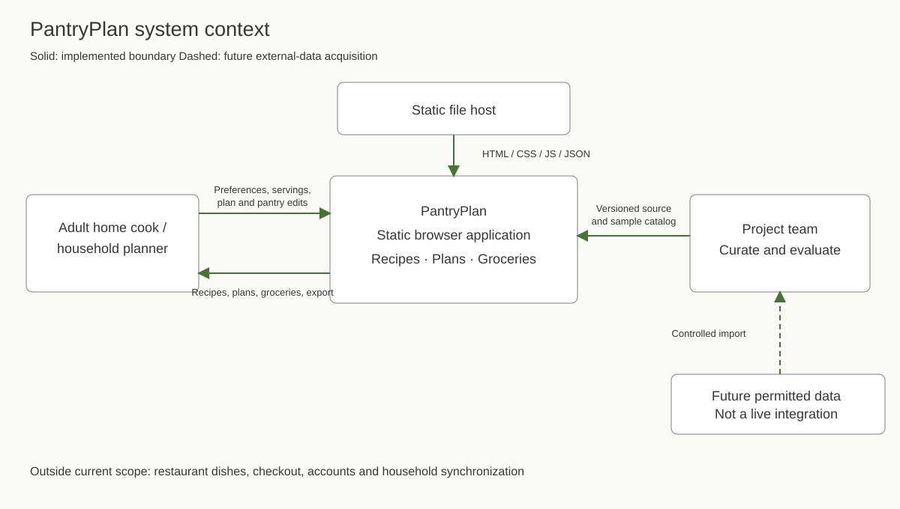
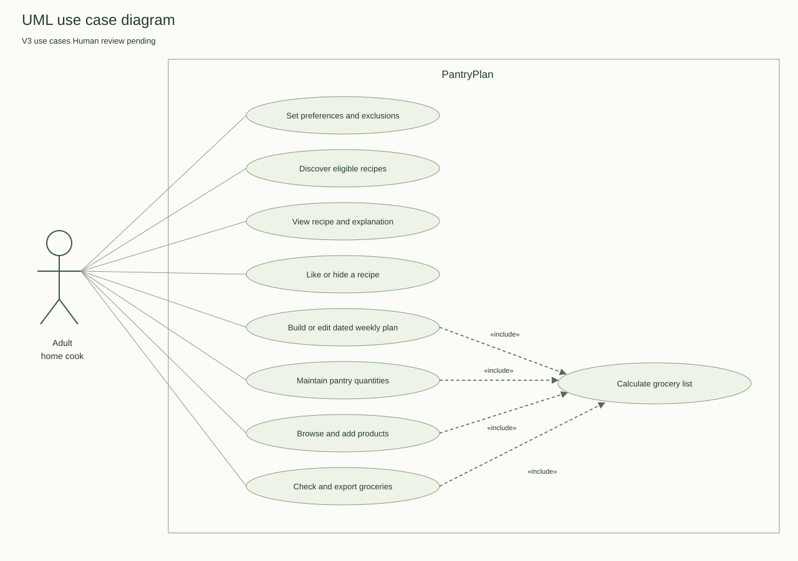
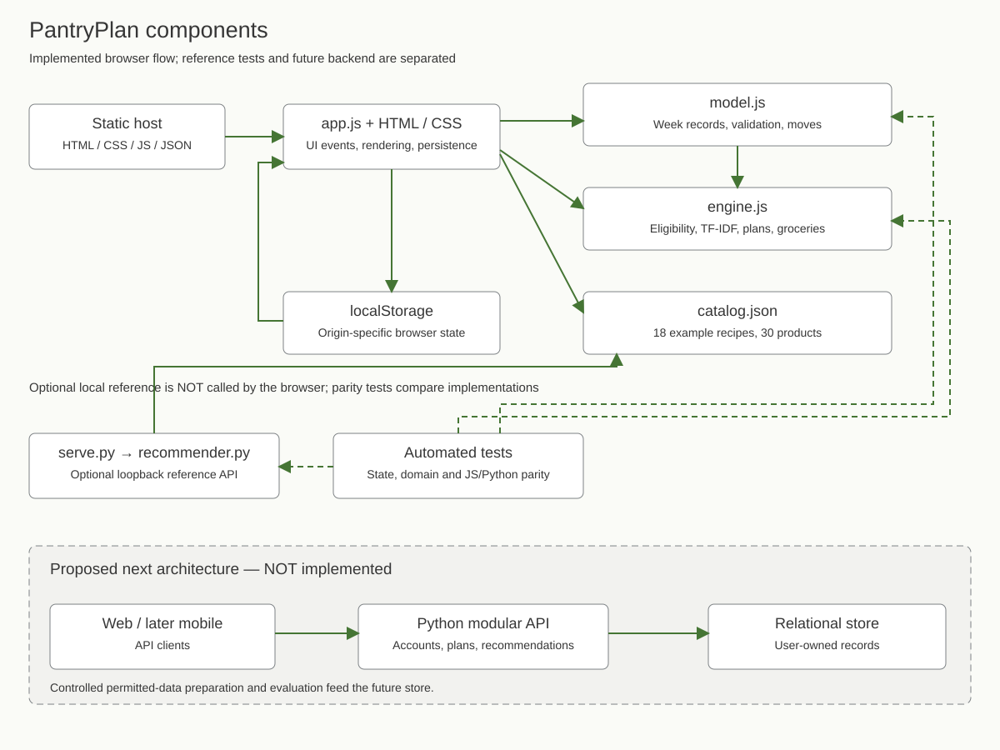

# PantryPlan remaining first-defense deliverables

Prepared 23 October 2026. This package completes document preparation; actual teammate/supervisor approvals, discussions and rehearsal are separate evidence gates. The frozen source tag is unchanged.

---

# Project proposal

## Title

Design and Development of an Intelligent Food Recommendation System Using Machine Learning

Working application name: PantryPlan. Team: Yerkebulan Abdissattar, Yerassyl Alimbek, and Ginayat Yerassyl. Supervisor named in the application: Praveen Kumar.

## Problem and intended users

People who cook at home must coordinate recipe choice, a sequence of meals, and the ingredients to buy. Preferences, available cooking time, existing pantry stock, and disliked ingredients can make that coordination harder. The current design target is adult home cooks coordinating meals for themselves or a household. Students who cook are a possible subgroup. Four anonymous questionnaire submissions informed the first requirements revision; they do not establish population demand, student-specific needs, or measured time/money savings. Final team and supervisor review remains pending.

Existing products already connect meal planning and grocery lists. The rationale is therefore to develop and evaluate an understandable recommendation and planning workflow for a defined user group, with explicit constraints and measurable comparisons. Any claim about a locally underserved audience or superior usability requires evidence.

## Aim

Design, implement, and evaluate a system that recommends recipes according to user preferences and constraints, organizes selected recipes into meal plans, and derives a grocery list from those plans and available pantry quantities.

## Objectives

1. Identify and validate target-user needs through 3–5 discussions or a substantive client agreement.
2. Critically review food recommendation research and compare existing systems and technical alternatives.
3. Define traceable functional/non-functional requirements and aligned architecture.
4. Prepare a documented recipe and ingredient dataset with canonical product identifiers and consistent units.
5. Implement a content-based recommender, a baseline, feedback handling, and inspectable recommendation explanations.
6. Integrate recipe discovery, editable meal planning, serving scaling, product browsing, pantry tracking, and grocery aggregation.
7. Evaluate ranking quality, hard-constraint compliance, grocery correctness, and user task performance under recorded conditions.

## Research questions

RQ1: Does a content-based recipe ranker improve relevance over a time-only baseline for the selected users and evaluation dataset?

RQ2: Can the integrated workflow correctly turn an edited meal plan and pantry quantities into an aggregated grocery list?

RQ3: Can target users complete recipe selection, plan editing, and grocery preparation, and understand why items were recommended?

RQ1 is untested. RQ2 has initial automated checks on sample data. RQ3 requires observed usability sessions.

## Scope and expected outcomes

The first implementation includes recipes, a generic grocery-product catalog, preferences and exclusion filters, a weekly plan, pantry amounts, grocery-list calculations, feedback, and a reproducible baseline comparison. Expected final artifacts are an application, documented dataset preparation, requirements, diagrams, source code, automated tests, an evaluation report, and a dissertation/presentation supported by actual evidence.

A product is a generic purchasable ingredient with a canonical ID, unit, and category. Recipe ingredients reference those IDs; the plan references recipes; the grocery list sums product quantities. Grocery recommendations initially mean the missing products required by the user's chosen meals, plus manual product additions. They are deterministic planning outputs, not a separately trained product recommender.

Restaurant dishes are excluded. Also deferred: delivery, checkout, live prices, retailer availability, brand matching, medical diet planning, exact nutrition optimization, image recognition, multi-household collaboration, and a separate native mobile client.

## Engineering complexity

The work includes canonical ingredient modeling, unit discipline, profile and exclusion handling, content representation, ranking and cold-start behavior, editable constrained planning, dependency-aware grocery recomputation, persistence, API contracts, test coverage, evaluation design, and traceability across team work. A final multi-user backend also requires authentication, authorization and data isolation; those are not implemented in V3.

## Success and validation

Success is not established by a functioning interface alone. The system must meet mandatory acceptance criteria, report zero known exclusion violations in the test suite, calculate quantities correctly, and be evaluated against an identical-candidate baseline. Ranking improvement and user benefit are hypotheses; report actual results, including negative findings. Metric definitions and proposed decision thresholds are in the evaluation plan.

## Evidence and first-defense status — 23 October 2026

Four consenting questionnaire submissions support pantry visibility, serving clarity, flexible plans and consolidated groceries. Findings F01–F08, eighteen functional requirements and ten evaluation scenarios are recorded in [the research review](https://github.com/Yerasylll/PantryPlan-food-recommendation/pull/2). This is self-administered survey evidence, not verified live discussions. Sources, counts and limitations must remain visible during the defense. The source prototype has 24 passing automated tests at commit e213081f9507cf1468a8392db877d8abaa5b9a28. Ranking superiority, measured user benefit and supervisor approval remain unestablished.

---

# Existing-system comparison

Checked 23 October 2026. Four systems are assessed using the same ten criteria. This is a documented-capability comparison of publicly accessible official material, not an account-based usability trial. Features may depend on tier, platform and region. **NE** means not established by the selected evidence, not absent.

## Official evidence register

| ID | System / source | Specific evidence and access limits |
|---|---|---|
| M | [Mealime getting-started guide](https://support.mealime.com/article/151-getting-started-guide) | Customization; automatic/manual planning; Grocery List; Pro Features. Public guide; Pro pantry selection is explicitly distinguished. |
| P1 | [Paprika features](https://www.paprikaapp.com/) | Recipe import, synchronization, aggregation and scaling. Platforms sold separately. |
| P2 | [Paprika 3 iOS guide](https://www.paprikaapp.com/help/iphone/) | Pantry and Meals sections. The page identifies Paprika 3 and links to a separate Paprika 4 beta guide; results must not be generalized to all versions. |
| S | [Samsung Food meal planner](https://samsungfood.com/meal-planner/) | Diet/avoidance controls, editable plans, shopping-list output and nutrition. Food+ is differentiated; no paid account was tested. |
| E | [Eat This Much](https://www.eatthismuch.com/) | Dietary planning, virtual pantry and automatic grocery updates. Public product descriptions; premium/platform behavior not exercised. |

## Matrix

| Consistent criterion | Mealime M | Paprika P1/P2 | Samsung Food S | Eat This Much E |
|---|---|---|---|---|
| Recipe discovery or organization | Curated recipe selection | Web recipe import/organization | Saved, created and community recipes | Foods/recipes in generated meals |
| Diet preferences | Diet types documented | Automated dietary profile: NE | Diet filters documented | Diet options documented |
| Ingredient avoidances | Allergies/dislikes documented | Automatic exclusion profile: NE | Avoidances documented | Food preferences; precise hard exclusions: NE |
| Automatic meal planning | Auto-builder | Automatic generation: NE | Personalized weekly plans via Food+ | Automatic plans |
| Manual/calendar editing | Self-serve meal selection | Daily/weekly/monthly planner | Move/edit recipes by day | Weekly planning; detailed edit semantics: NE |
| Combined grocery output | Combined recipe quantities | Similar ingredients combined | Plan-to-shopping-list output | Grocery updates from weekly meals |
| Pantry awareness | Pro: choose ingredients to use | Quantity/stock records; pantry items unchecked | Exact pantry arithmetic: NE | Virtual pantry prioritized |
| Serving adjustment | Per-recipe servings documented | Ingredient scaling documented | Exact serving scaling: NE in selected page | Precise serving scaling: NE in selected page |
| Nutrition information | Preferences/nutrition goals described | Full nutrition automation: NE here | Nutrition breakdown described | Calorie/macro goals described |
| Published ranking algorithm and reproducible baseline | NE | NE | AI claims; reproducible method NE | Automation claims; reproducible method NE |

## Engineering implications

Planning and groceries are established product capabilities. PantryPlan cannot claim they are missing from competitors. The project instead exposes an inspectable ranking/baseline implementation, canonical quantities, dated verification and requirements informed by a defined sample. This is an engineering/evaluation focus, not proof of superiority or a unique market gap.

The four-response findings prioritize pantry visibility, flexible scheduling, practical serving quantities and consolidated purchases. They do not demonstrate that another app fails at these tasks. P2 describes pantry-based unchecking; exact numeric subtraction must not be inferred from that description. Mealime pantry selection is explicitly a Pro capability. Samsung personalization has Food+ distinctions. These qualifications prevent a false binary comparison.

Optional later fieldwork: test the same recipe-to-plan-to-list scenario in authorized versions, record platform/tier/date and outcomes, and retain permitted screenshots. That is a later validation method, not a claimed completed activity. Assessment coverage: four systems × ten consistent criteria; PP-12.

---

# Technology comparison and architecture decisions

Evidence rechecked 23 October 2026; PP-13.

The team reports Python, cross-platform mobile, HTML, CSS and JavaScript experience. We propose a web-first workflow for the first defense and a Python-backed service for the full implementation. Decisions remain subject to team and supervisor review. The current static prototype is deliberately smaller than that final architecture.

## Decision 1 Application API

| Alternative | Fit and strengths | Cost / trade-off | Proposed decision |
|---|---|---|---|
| FastAPI | Python code can share preprocessing and model code; typed request handling and API documentation | Authentication, persistence and deployment still need explicit implementation | Preferred for next backend iteration |
| Django with an API layer | Python ecosystem; integrated models, admin and authentication facilities | More framework concepts for a small experiment; API layer and boundaries must be chosen | Prefer if administration/account workflows dominate |
| Express | JavaScript across frontend/backend; flexible API routing | Python model code would require another service or a JS implementation | Valid team-skilled alternative, not first choice |

Evidence: [FastAPI](https://fastapi.tiangolo.com/features/), [Django](https://docs.djangoproject.com/en/stable/intro/overview/), [Express](https://expressjs.com/). Framework fit and relative implementation effort above are our engineering judgment, not measured speed claims. Current implementation: loopback-only standard-library Python experiment API; browser runs JS ranking locally.

## Decision 2 Persistent data store

| Alternative | Fit and strengths | Cost / trade-off | Proposed decision |
|---|---|---|---|
| SQLite | Embedded relational store; useful local operation without a separate database server | One writer at a time; many concurrent writers favor a client/server store. Some web workloads can still use SQLite. | Suitable local-development option |
| PostgreSQL | Relational constraints, foreign keys and transactions fit recipe/product/plan relationships | Requires a database service, migrations, backup and credentials | Preferred target for a multi-user backend |
| MongoDB | Flexible document model fits imported recipe records | Cross-entity product references and shared grocery updates need deliberate modeling | Reconsider if document ingestion outweighs relational needs |

Evidence: [SQLite](https://www.sqlite.org/whentouse.html), [PostgreSQL](https://www.postgresql.org/docs/current/tutorial-transactions.html), [MongoDB](https://www.mongodb.com/docs/manual/data-modeling/). The relational preference is our inference from the proposed data model. Current persistence is browser localStorage plus a read-only JSON catalog; no database is implemented.

## Decision 3 Recommendation representation

| Alternative | Fit and strengths | Cost / trade-off | Proposed decision |
|---|---|---|---|
| TF-IDF content vectors with cosine similarity | Works with item features and stated preferences; fitted weights and matched ingredients are inspectable | Exact canonical tokens miss semantic relationships; score is not a probability of satisfaction | Implement first; compare with a baseline |
| Collaborative filtering / matrix factorization | Can model patterns from users' interactions | Needs usable interaction history; cold-start users/items require handling | Evaluate after obtaining licensed interaction data |
| Pretrained text embeddings | Can represent semantic similarity in text | Model size, licensing, inference cost and domain suitability need evaluation | Candidate second content model if time and data permit |

Evidence: [scikit-learn text features](https://scikit-learn.org/stable/modules/feature_extraction.html#text-feature-extraction), [Google collaborative filtering guide](https://developers.google.com/machine-learning/recommendation/collaborative/basics), [Sentence Transformers](https://www.sbert.net/), and RecipeRec in the literature review. Suitability is a project decision; no method is assumed to win before evaluation.

## Decision 4 Client delivery

Alternatives: vanilla HTML/CSS/JS responsive web; a component-framework web client; a cross-platform mobile client. The first prototype uses the first option because it starts without dependencies and is directly reviewable. This is not a commitment to the final UI framework. Move to a component framework when state/interaction complexity justifies it; build a mobile client after the API and core domain behavior stabilize. Team experience supports all three, but maintaining two clients before validating requirements adds work.

## Architecture decision record

ADR-001: Prototype runs without third-party runtime packages and uses illustrative data. Status: implemented starter decision; team ratification pending. Consequence: quick reproducible demo, limited fidelity and scale.

ADR-002: Filter before ranking; never fill impossible slots with excluded recipes. Status: implemented. Consequence: partial plans are allowed and explained.

ADR-003: Grocery arithmetic uses canonical products and one canonical unit per product. Status: implemented. Consequence: no implicit mass-to-volume conversion or brand substitutions.

ADR-004: Future central backend uses Python and serves both clients; adopt FastAPI/PostgreSQL after review. Status: proposed; not implemented. Consequence: replace browser-local authority and implement account/data isolation.

## Decision 5 Prototype hosting

| Alternative | Requirement fit | Trade-off | Decision |
|---|---|---|---|
| GitHub Pages | Serves the existing static ES-module frontend from the public repository | No Python execution, accounts or server database; deployment follows configured branch | Selected for the public V3 prototype; configured on main/root on 23 October 2026 |
| Render Static Site | Also serves static frontend files | Separate provider account/settings; no Python API on static hosting | Valid alternative; not used in this deployment |
| Python web service | Can run a proper API/backend after engineering work | Server lifecycle, persistence, security and deployment must be implemented | Deferred; the loopback standard-library server is not the production solution |

References: [GitHub Pages overview](https://docs.github.com/en/pages/getting-started-with-github-pages/what-is-github-pages), [Render static sites](https://render.com/docs/static-sites). The project uses relative asset paths and hash routes; verify deployment results rather than treating a saved setting as a successful deployment.

Decision conditions: adopt the central backend only when accounts, ownership and shared plans are agreed requirements. Compare TF-IDF with the same eligible-candidate baseline before considering interaction-heavy or embedding models. Select a specific embedding model only after checking its model-card license, hardware/runtime and evaluation results. Framework/library links document capabilities; relative project effort and preferred options are engineering judgments, not benchmark findings. At least three decisions each have three alternatives above; proposed choices still need human review.

---

# Data provenance and acquisition decision

Checked 23 October 2026; PP-14. Current source: [catalog.json at the submitted commit](https://github.com/Yerasylll/PantryPlan-food-recommendation/blob/e213081f9507cf1468a8392db877d8abaa5b9a28/catalog.json).

| Field | Record |
|---|---|
| Artifact | catalog.json, UTF-8 JSON |
| Source commit | e213081f9507cf1468a8392db877d8abaa5b9a28 |
| SHA-256 of exact bytes | `8d952781d52669c8e21c27e373dca2803171179b283ce254fe1205a944c5cc2a` |
| Records | 18 illustrative recipes; 30 generic products |
| Units actually present | each, g, ml |
| Origin | Authored for the prototype with assistant support; not scraped from a recipe site or imported from an external research dataset |
| Personal records | None in the catalog; no real interaction history |
| Evidence status | Example times/quantities and declared labels; not measured cooking, validated nutrition or allergen-safety data |
| Dataset release | No external research dataset acquired or approved for redistribution |

## Schema and invariants

Products: `id`, `name`, `unit`, `category`, `allergens`, `vegan`, `vegetarian`. Recipes: `id`, `name`, `meal`, `minutes`, `style`, `servings`, ingredient rows, steps and declared/derived dietary labels. Each ingredient row references `productId` and a positive `quantity`. Recipe/product IDs are unique. One product has one canonical unit; no implicit mass/volume conversion is performed. Catalog validation and label/reference checks are part of the 24-test suite.

Recipes are scaled by selected servings/base servings. Grocery need is summed across the selected week and direct additions, then pantry stock is subtracted once per product and clamped at zero. Pantry does not alter the current recipe ranking. Fractional calculated needs and whole-unit pantry/addition validation are separate: proposed whole-item purchase rounding is not implemented.

## Candidate research resources and decision

| Candidate / primary source | Potential use | Access/provenance findings | Decision |
|---|---|---|---|
| [Majumder et al. author repository](https://github.com/majumderb/recipe-personalization) | Historical recipe/user-preference research; foundational S8 | Author repository relates to the EMNLP 2019 work. Availability does not establish permission for underlying recipe text/images or redistribution of user records. | Candidate only; no download/import/redistribution approved. Verify original data terms and sensitive fields before acquisition. |
| [RecipeRec author repository](https://github.com/meettyj/RecipeRec) | Interaction/graph ranking experiments; S4 | Official README links a separate data download and describes graph-to-recipe/user mappings. Mapping availability does not establish a usable grocery-quantity schema or blanket data license. | Candidate only; check data-specific permission, mappings and suitability before acquisition. |

**Selected first-defense data:** retain the authored sample for functional verification. Do not represent it as a real-user ranking benchmark. For subsequent quality evaluation, obtain a permitted interaction dataset or collect consented relevance judgments; record the actual authorization and all transformations first.

## Reproducible preparation contract

Record URL/owner, terms/license, access date, version/hash, attribution and redistribution restrictions. Inspect user identifiers; remove unnecessary personal fields. Preserve recipe IDs and canonical ingredient mappings. Deduplicate before splitting and use chronological per-user separation where histories exist. Fit feature statistics on permitted training data; freeze test judgments, candidates and random seeds. Normalize units only with documented compatible conversions; report unmatched ingredients and coverage losses. Retain raw restricted data outside public Git and publish only permitted derived artifacts.

Four questionnaire submissions are separate user-research evidence. Public documents contain counts and anonymized paraphrases; no participant identity, exact response timestamp, or row-level linked profile is part of this catalog or ranking dataset. Repository visibility is not a license grant; team licensing decisions remain to be agreed before claiming third-party reuse rights.

---

# Architecture aligned with the submitted V3 source

Checked 23 October 2026 against commit e213081f9507cf1468a8392db877d8abaa5b9a28. Related tasks PP-15–PP-17. Diagrams describe the current static prototype and separately identified future scope; they do not depict an implemented backend.

## Current components

- `index.html` and `styles.css`: application shell and responsive presentation.
- `app.js`: UI events, view rendering, dialog controls, loading the JSON catalog, and writing state to browser localStorage.
- `model.js`: schema validation, Monday date keys, plans indexed by week, per-week direct additions/check flags, pantry/profile state, profile reconciliation, and within-column meal moves/swaps.
- `engine.js`: eligibility filtering, TF-IDF ranking, deterministic baseline, generation, serving scaling and grocery arithmetic. It does not call a model service.
- `catalog.json`: authored example records shared by the JS and Python implementations.
- `scripts/serve.py`: optional loopback static server plus GET /api/catalog and POST /api/recommend; `scripts/recommender.py` implements reference ranking. The frontend does not call these endpoints.
- `tests/`: domain/state assertions and Python/JavaScript ranking agreement.

Actual state keys include `schema`, title, selected week, profile, servings, ranking mode, layout/day filter, `plans[week]`, global pantry, `extras[week]` and `checked[week]`. A week key is a Monday date, not a reusable undated template. Pantry stock is global to the browser state; plans/additions/check flags are scoped by selected week. Hidden/liked feedback lives in the profile. Same-column moves swap occupied day slots; cross-meal-column moves are rejected.

The static deployment serves the same browser files. There is no authentication, shared authoritative storage, retailer connection or server-side recommendation path. An origin-specific browser store is not cross-device sync. Export is a snapshot, not live collaboration.

## Recommendation and grocery contracts

For N catalog recipes: IDF(t) = 1 + ln((1+N)/(1+df(t))). Recipe canonical product/style tokens use count TF, IDF weights and L2 normalization. The preference/liked-recipe query uses the same vocabulary/weights. Eligible items are ranked by cosine score, then time and ID. Empty/unknown queries have deterministic fallback. Diet, time, product exclusions, declared allergens and hidden recipes are constraints, not soft ranking preferences. The baseline applies identical eligibility and orders by time/ID. Scores are not probabilities of satisfaction.

Generation uses a usage-count heuristic to rotate compatible meals; it is not optimized nutrition or a budget solver. Partial plans remain valid when no eligible recipe exists. Groceries use canonical IDs and units: sum scaled recipe needs and direct additions, then subtract pantry once and clamp at zero. No implicit unit conversion or automatic substitution is implemented.

## Diagram package

| View | Editable source | Readable export | Boundary |
|---|---|---|---|
| Context | context.mmd | context.svg | Actual static system, home cook and team; future imports distinguished |
| UML use cases | use-cases.puml | use-cases.svg | User interactions and automatic grocery recalculation |
| Components | components.mmd | components.svg | app/model/engine/catalog/store/reference server, plus separate proposed backend |

SVG files are editable vector exports prepared to match the accompanying source diagrams. They are not claimed to be generated by a particular Mermaid/PlantUML version. No source-only diagram is presented as an export. Review actor, relation and boundary equivalence when changing either representation.

## Proposed next architecture

Use a modular Python service, initially one deployable application, for accounts/ownership, profiles, plans, recommendation and grocery logic. A controlled import/evaluation process prepares permitted data. A relational store supports canonical product/recipe relationships and future user ownership. Web and any later mobile client use a documented API. Do not split into network microservices without a measured need. Account isolation, sync conflict rules, migrations, backups and evaluation-data handling must be implemented and tested before claiming a multi-user system.

## Requirements-to-component trace

| Behavior | Components | Verification |
|---|---|---|
| Eligible, explainable recipe selection | app + engine + catalog | Constraint/vector/fallback/parity tests; later observed comprehension |
| Dated editable plans and moves | app + model + engine | Week-boundary/state/move tests; browser scenarios |
| Pantry-aware consolidated groceries | app + engine + model | Serving, aggregation, subtraction tests and manual scenario |
| Persistence and recovery | app localStorage + model validation | Reload/malformed-record checks |
| Household sharing | Future API/store | Not implemented; no current pass claimed |
| Purchase rounding | Proposed requirement | Design walkthrough only, not implemented |

---

# Human review and defense handoff

Prepared 23 October 2026. These are blank evidence templates and suggested checks, not completed interviews, approvals or rehearsals.

## Teammate review

Record reviewer, date, artifact/commit, substantive comment, decision/change and recheck. Literature owners must check their assigned source locators and be able to explain methods, limits and implications. Review research PR #2, README PR #3 and the design/comparison review branch. A reviewer assignment is not approval.

## Supervisor review

Show scope/target group, critical review, findings/requirements, comparisons, architecture and evaluation. Ask whether the target group and evidence route are acceptable, whether the engineering/ML contribution is sufficient, and which evaluation conditions need adjustment. Retain the actual response and link revisions. Do not fill a supervisor-feedback record before receiving it.

## Suggested 10-minute defense sequence

1. Title, team, supervisor and problem (45 seconds).
2. Scope and expected outcomes (45 seconds).
3. Four-response findings and the live-discussion limitation (60 seconds).
4. Literature: eight scientific/four technical sources; compare methods and limits (90 seconds).
5. Four-system comparison and technology decisions (60 seconds).
6. Context/use-case/component diagrams and actual vs proposed boundaries (90 seconds).
7. Prototype demonstration: recipe → dated plan → pantry → grocery list (90 seconds).
8. Exact-commit 24-test results and planned ranking/usability evaluation (60 seconds).
9. GitHub–YouTrack trace, release, risks and remaining human evidence (60 seconds).

Each teammate should explain their own assigned work. Rehearse against the actual demo URL; prepare the local source as fallback. Time a real run, record questions/defects and revise. The outline itself is not a finished slide deck or completed rehearsal.

## Final submission audit

Check committee/supervisor access, documentation PR review/merge status, editable and exported diagrams, demo behavior, actual discussion and supervisor records, per-member commits/reviews, test conditions, and outstanding tasks. The existing pre-defense-1 tag remains on its original source commit. New documents prepared after that tag are outside the frozen snapshot; do not silently move it. Confirm with the department how supplemental review documents should be submitted.

## Diagram exports

Editable sources: [context](context.mmd), [use cases](use-cases.puml), [components](components.mmd).

---

# Static deployment and browser verification

Executed 23 October 2026. Tasks PP-26 and PP-28. Public URL: https://yerasylll.github.io/PantryPlan-food-recommendation/ . GitHub Pages was enabled for main / repository root. GitHub settings reported the site live; the public page loaded successfully. The main source head at configuration was e213081f9507cf1468a8392db877d8abaa5b9a28. Application source was not changed; asset-by-asset deployment hashes were not independently measured.

## Observed outcomes

| Check | Condition / actual observation | Result |
|---|---|---|
| Startup and recipe data | Public HTTPS page loaded all 18 recipe cards | Pass |
| Search | Entered chickpea; one matching Lemon chickpea salad card remained | Pass |
| Recipe details by keyboard | Enter activated the recipe button; ingredients, method and declared sample allergens appeared | Pass |
| Meal scheduling | Enter opened Add to plan; Tuesday lunch saved as Lemon chickpea salad for two servings; edit dialog retained these values | Pass |
| Grocery recomputation | Selected week displayed 21 planned meals; total cooked chickpeas needed was 800 g after the edit | Pass |
| Pantry subtraction | Actual keyboard entry of 200 g pantry stock produced 800 g required / 200 g pantry / 600 g to buy | Pass |
| Checklist persistence | Marked chickpeas purchased; after reload the checkbox remained checked and the counter showed one purchased item | Pass |
| Export | Export list produced the dated pantryplan-groceries-2026-10-19.txt download | Pass |
| Week isolation | Following week displayed empty slots; returning to current week restored its 21 meals | Pass |
| Desktop | Current weekly planner observed at 1440 × 1000; screenshot retained locally | Pass for inspected view |
| Mobile layout | Chrome viewport emulation at 390 × 844: recipes rendered, page width 390 px matched viewport width 390 px; no page-wide horizontal overflow in inspected recipe view | Pass for inspected view |
| Mobile navigation | Enter opened navigation and activated Grocery list; grocery heading rendered | Pass |
| Captured console | Final Chrome live check returned no captured error entries | No errors captured in that observation |

Temporary viewport overrides were reset after testing. Test-only changes affected browser-local state in verification sessions, not another user's account or shared server records.

## Limits and remaining evaluation

This is a bounded assistant-run smoke/acceptance check using recorded actions, not full accessibility certification, a real-phone test or observed-user usability study. Complete keyboard tab order/focus restoration, screen reader behavior, drag/swap alternatives, every export/edit edge case, and additional browsers remain broader QA work. Twenty-four automated domain/state/reference-parity tests passed separately against the frozen source; no new source tests were necessary for documentation-only changes. Planned ranking evaluation and user benefit remain unmeasured.

Static hosting executes the browser JavaScript and serves catalog.json. It does not run scripts/serve.py or expose the Python API. GitHub Pages was selected instead of Render for this prototype; no Render deployment is claimed. Keep the public demo URL in the README and YouTrack. The site follows main going forward; the pre-defense-1 tag remains the fixed source submission reference.
